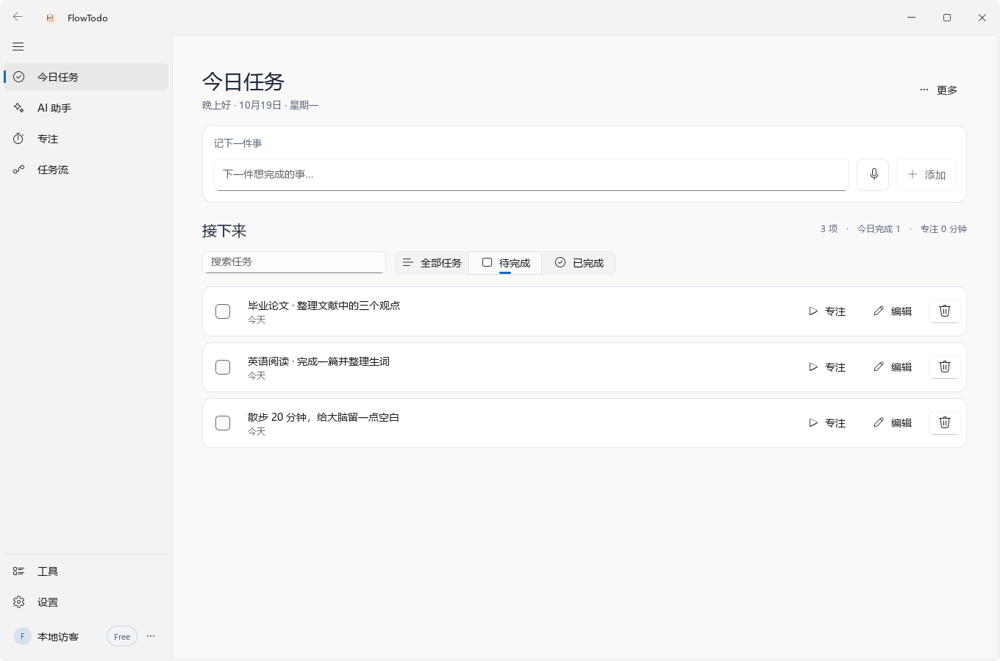
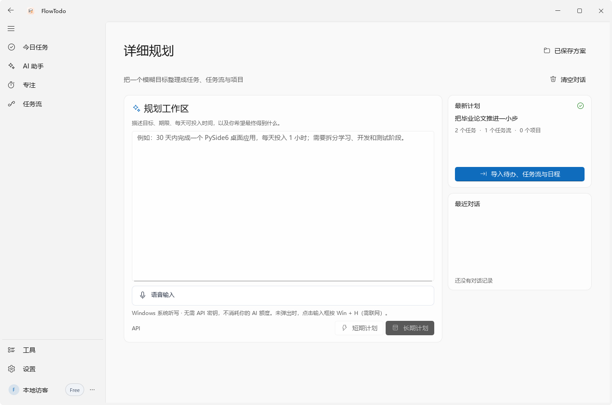
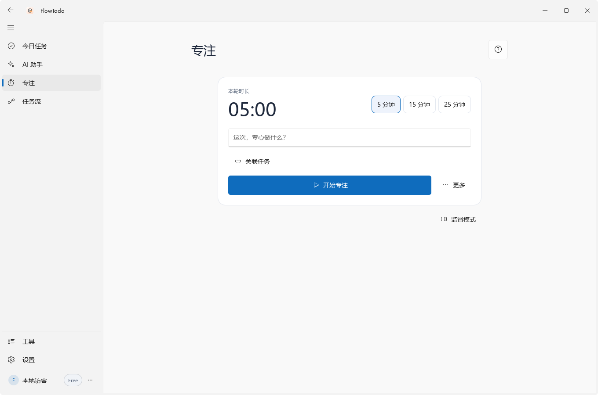
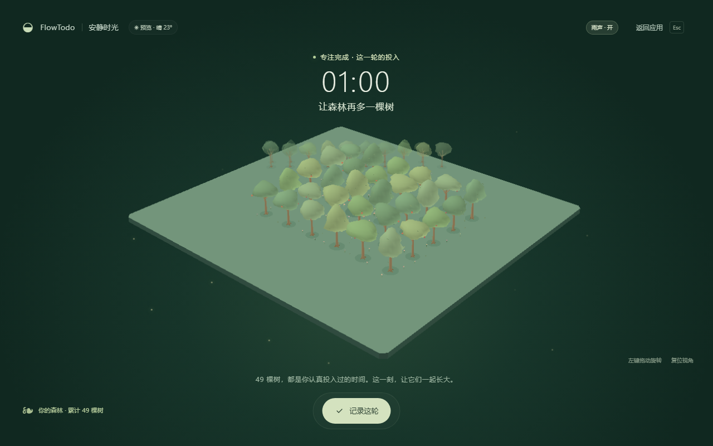
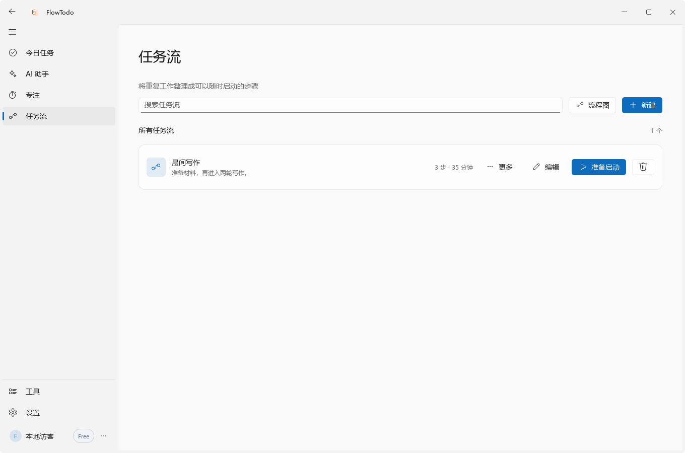
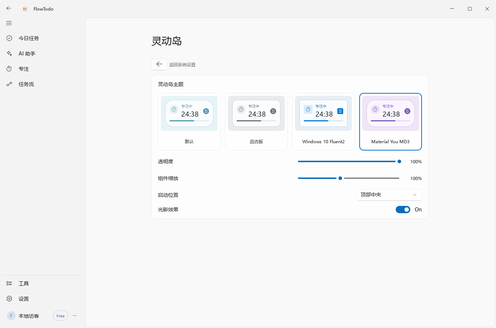
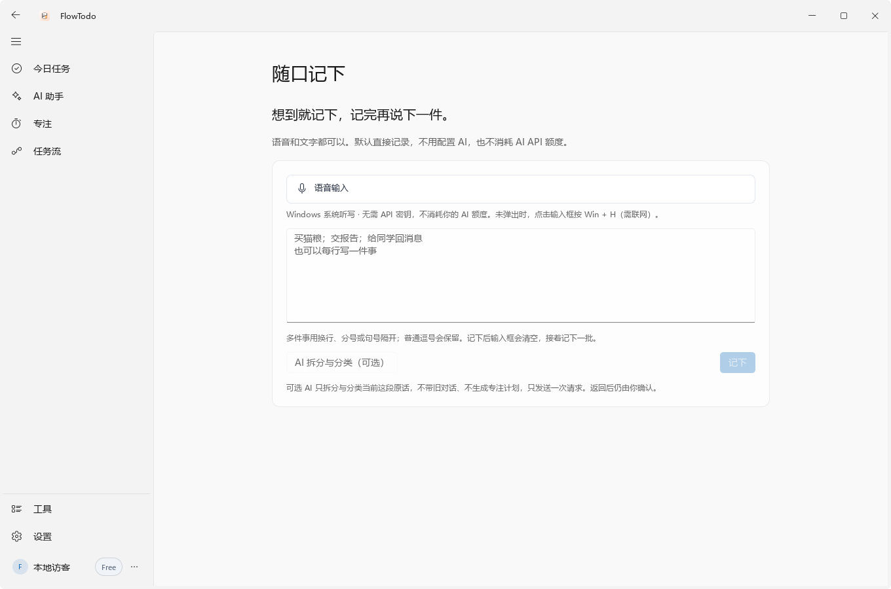

<div align="center">


# FlowTodo

### 让想法，有下一步。

把脑子里的一团事，变成看得见的任务、做得下去的计划，以及真正投入的时间。

[下载 Windows 版](https://github.com/inksans114/FlowTodo-FluentUI-version/releases) · [官方网站](https://app.cheemsdoge.xyz) · [反馈问题](https://github.com/inksans114/FlowTodo-FluentUI-version/issues)




**记下来 → 理清楚 → 开始做 → 留下进展。**

</div>

## 为什么做 FlowTodo？

有时候，难的不是列出十件事，而是决定现在先做哪一件。

FlowTodo 把任务、AI 规划和专注放进同一套桌面工作流：先随口记下一个想法，再把计划导入待办、任务流与日程，最后从一个小目标开始。中途被打断，也能留下接续点，下次接着做。

**适合课业很多的学生、想稳定推进项目的人，以及喜欢简洁桌面工具的你。** 不用 AI、不注册账号，也能使用本地待办和基础专注。

## 01 · 一句话起步，计划真正落地

文字输入或系统听写，把模糊目标说清楚。AI 助手提供行动引导，详细规划可以导入原生待办、任务流、项目与日程；保存的方案能够重新打开，继续修改和使用。



> 图中方案使用演示数据。AI 输出效果取决于所选模型，导入前可以检查内容。支持官方通道或自行配置兼容接口，官方可用额度以账户页面为准。

## 02 · 从“要做很多事”，到“先做这一小步”

选择一个目标和时长，开始普通专注或番茄节奏。暂停时记录进展和下一步，结束时回顾这一轮；任务是否完成，由你决定。



想换个氛围，还可以进入独立的 **生长之森 / 专注小屋** 沉浸窗口。完成专注，慢慢积累自己的森林；也可以一直使用普通界面。



## 03 · 重复的流程，安排一次就够了

把“准备材料 → 专心做事 → 休息一下”存成任务流，下次直接启动。任务、任务流和项目可以关联，把零散事项串成连续行动。



## 04 · 留在桌面上，也别挡住你

轻量待办组件把任务留在手边；灵动岛显示专注状态。主题、透明度与缩放可以调整，桌面便签用于临时记录。新版简化了待办组件，也修正了文字、图标与预览的对齐。



## 05 · 想到就记，不必每次都请求 AI

“随口记下”支持文字和 Windows 系统听写，多件事可以批量预览再保存。AI 拆分是可选项，普通记录可以直接完成。



## 还有这些贴心细节

| 能力 | 可以怎么用 |
| --- | --- |
| 本地优先 | 日常任务与记录保存在本机，账号与云服务按需使用 |
| 云端记录 | 登录后在软件内同步、导入和管理待办、任务流与 AI 方案；网站显示账户与用量 |
| 方案留存 | 保存、搜索、复制和重新打开 AI 方案，保留自己的思路 |
| 专注数据 | 查看专注时长、历史活动与完成记录 |
| 外观与动效 | 明暗主题、窗口材质、轻量动效；付费方案支持更多个性化设置 |
| 可选监督 | 摄像头姿态与屏幕文字检测在本机处理，需主动开启；检测只作提示，可能误判 |
| 桌面工具 | 便签、任务组件、灵动岛与 Windows 开机启动设置 |

云端同步与官方 AI 需要联网及对应账户权限，服务仍在持续完善。监督与手机镜头是可选功能；macOS 构建为测试版，Windows 专属能力不能直接照搬。

## 下载与开始使用

前往 [Releases 下载页](https://github.com/inksans114/FlowTodo-FluentUI-version/releases)，选择 `FlowTodo-Windows-x64-版本号.zip`，**完整解压**后运行 `FlowTodo.exe`，保留旁边的资源文件。源码压缩包不能代替 Windows 应用。

1. 在“今日任务”里记下一件现在想推进的事。
2. 选择任务，或者直接打开“专注”，给自己一小段时间。
3. 有复杂目标时再让 AI 帮你整理；需要云端记录时再登录账号。

Windows 数据默认位于 `%LOCALAPPDATA%\FlowTodo\data`，升级前建议备份该目录。

## 从源码运行

推荐 **Python 3.12 x64 + Windows 10 / 11**。界面基于 [RinUI](https://github.com/RinLit-233-shiroko/Rin-UI)，仓库内附本项目使用的版本。

```powershell
git clone https://github.com/inksans114/FlowTodo-FluentUI-version.git
cd FlowTodo-FluentUI-version
python -m venv .venv
.\.venv\Scripts\python -m pip install -r requirements.txt
.\.venv\Scripts\python app.py
```

需要本地监督功能时，再用同一 Python 环境执行 `tools/prepare_supervision_models.py` 准备模型。Windows 语音默认调用系统 `Win + H`，需要麦克风、系统权限与联网；可选云端转写可能产生服务费用。

[详细功能说明](docs/FEATURE_GUIDE.md) · [构建与发布](RELEASING.md) · [macOS 测试版](docs/MACOS_BUILD.md) · [2.3.0 更新记录](docs/releases/2.3.0.md)

## 一起把它做得更好

遇到布局问题、同步失败，或有更顺手的交互想法，欢迎 [提交 Issue](https://github.com/inksans114/FlowTodo-FluentUI-version/issues)，附上操作步骤、系统版本和截图，请遮住个人信息。

如果它帮你开始了一件原本拖着的事，欢迎点一个 **Star**，也欢迎分享给需要它的人。

本项目采用 [MIT License](LICENSE)。第三方说明：[RinUI](vendor/LICENSE)、[Class Widgets 设计参考](CLASS_WIDGETS_2_LICENSE.txt)、[场景音频](focus-studio/assets/NOTICE.md)、[监督模型](supervision-models/NOTICE.md)。本页图片来自真实运行界面，使用临时演示数据；开发与文档编写有 AI 辅助。
